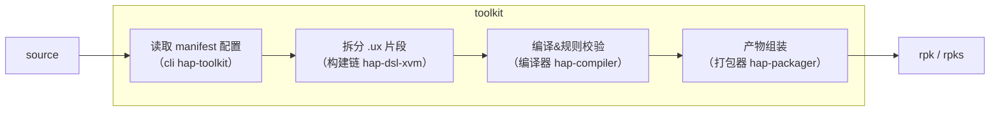
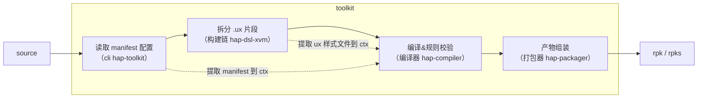
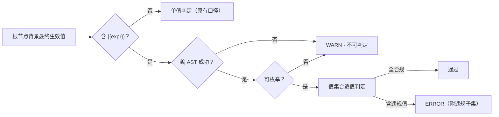
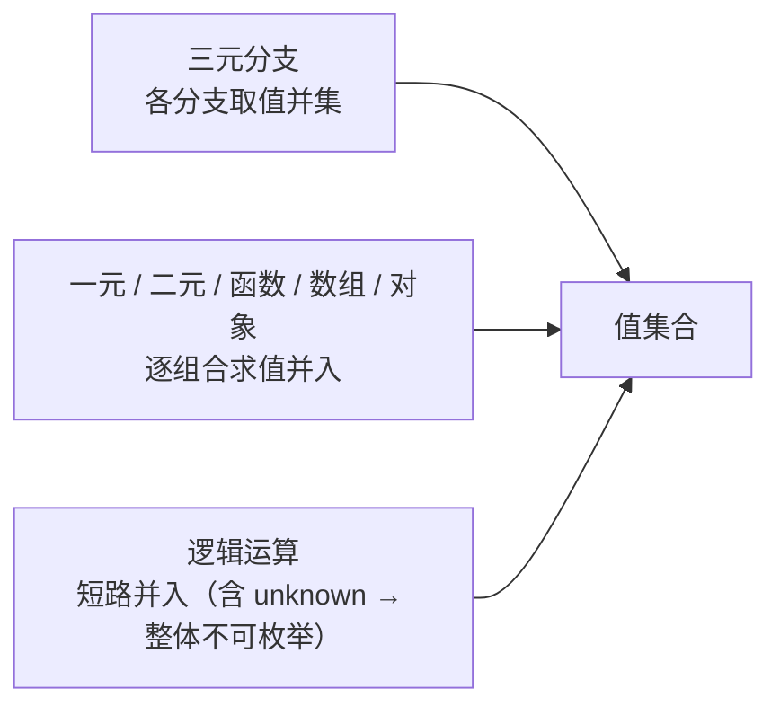
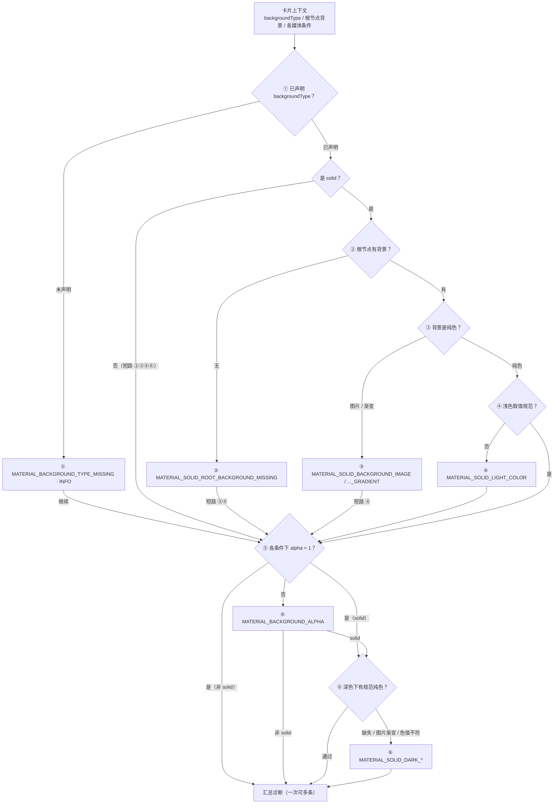

# 技术方案 - 轻卡高级材质编译支持（draft）

## 目标与范围

### 平台契约

| 契约项                            | 定义                                            |
| --------------------------------- | ----------------------------------------------- |
| `backgroundType`（manifest 字段） | `solid`（规范纯色）/ `custom`（自绘背景，默认） |
| `prefers-material`（媒体特征）    | `none` / `frosted` / `glass`，默认 `none`       |

宿主参数与材质渲染细节见[《接入快应用卡片高级材质（v2 · 对齐 backgroundType 声明式方案）》](https://mi.feishu.cn/docx/Sj4jdNP6wozlPfx85ULcAhBInrc)。

### 主要目标

| 主要目标                                 | 说明                                                       |
| ---------------------------------------- | ---------------------------------------------------------- |
| `@media (prefers-material)` 编入产物     | 不注册则整条规则被丢弃，材质样式不生效                     |
| 背景违规可在编译期被发现、定位并指引修复 | 一条链路：规则（发现）→ 行列号（定位）→ 规范链接（怎么改） |

### 目标分拆

- 分拆方式：结合流程与主要目标，拆出可独立描述子目标

  > 每个子目标回答「在哪个环节、做什么、完成后得到什么」

- 流程与组件见下图



组件职责（画板内表格，转写）：

| 组件（落地位置）       | 职责                                                                                            |
| ---------------------- | ----------------------------------------------------------------------------------------------- |
| cli（hap-toolkit）     | 读 manifest 生成编译入口、schema 校验                                                           |
| 构建链（hap-dsl-xvm）  | ux-loader / fragment-loader / style-loader；拆分 `.ux` 片段、读取 manifest 与根节点并透传上下文 |
| 编译器（hap-compiler） | 解析模板 / 样式并执行校验；样式校验由 style-loader 调用 `parseStyle` 触发                       |
| 打包器（hap-packager） | 组装产物                                                                                        |

| 主目标                                   | 子目标                                                             | 对应流程                            |
| ---------------------------------------- | ------------------------------------------------------------------ | ----------------------------------- |
| `@media (prefers-material)` 编入产物     | 材质样式编入产物：注册 `prefers-material`，`@media` 不再被整条丢弃 | 编译器：媒体特征白名单              |
| 背景违规可在编译期被发现、定位并指引修复 | 非法取值编译前拦截：`backgroundType` 收敛到 schema 枚举            | CLI：manifest schema                |
| 背景违规可在编译期被发现、定位并指引修复 | 背景违规编译期检出：基于卡片声明与根节点判定                       | 编译器：校验框架                    |
| 背景违规可在编译期被发现、定位并指引修复 | 错误可定位、可修复：提供行号信息                                   | 编译器：源码位置信息 + 诊断输出通道 |

## 方案

### 编译前：取值校验收敛到 schema——取值错误尽早拦截

- manifest schema 是 toolkit 内置的**字段规则表**：声明式规则描述 manifest.json 各字段的类型 / 必填 / 枚举与报错文案

  ```JavaScript
  export default {
    type: 'object',
    required: ['package', 'name', 'icon', 'versionCode', 'config', 'router'],
    properties: {
      package: {
        type: 'string',
        errorMessage: ' 字段必须为 string 类型'
      },
   //...
  ```

- 编译启动时（CLI 读 manifest、生成编译入口阶段）由 Ajv（JSON Schema 校验引擎）逐字段比对，一次报出全部问题，只提示、不中断构建

```js
// ① 规则表（声明式，节选）——本次只加一行
properties: {
  // …既有字段已按此模式声明
  backgroundType: {
    enum: ['solid', 'custom']
  } // ← 本次新增
}

// ② 执行：编译启动时由既有通道统一校验；失败逐条报出（字段 + 原因 + 参考文档，不中断构建）
ajv.validate(schema, manifest)
```

**本次改动**

把 `backgroundType` 加入规则表——只约束取值（`solid | custom` 枚举），不设为必填（缺省按 `custom`；未声明的提示由「背景规范校验」的规则给出）。

- 非法取值与其它字段走同一通道：编译前提示、含字段路径 + 期望取值 + 参考文档、不阻塞打包；
- 字段级检查由 schema 单一实现（规则表加一行），样式校验（「背景规范校验」）不重复报告同类问题。

### 编译中：注册 `prefers-material`——材质样式不再被丢弃

**现状**：

- 编译器通过**媒体特征白名单**决定 `@media` 能否编出
- 流程是「查表 → 调用对应校验器」：

  1. `featureValidatorMap` 把特征映射到校验器，`featureValidator` 负责取值校验；
  2. 未注册或取值非法 → 条件置空，整条 `@media` 被丢弃（仅 WARN），样式不会进产物。

**本次改动**：白名单加一行 + 补一个校验器，调用路径不变：

```js
// mediaquery.js（伪代码，← 为本次改动）

// ① 白名单：特征 → 校验器（未注册 = 不识别）
const featureValidatorMap = {
  'prefers-color-scheme': 'preferColorScheme',
  // …其余 20 余个
  'prefers-material': 'preferMaterial' // ← 注册特征
}

// ② 取值校验器：只认 none | frosted | glass（小写精确匹配）
//    契约与既有校验器一致：合法返回 { value }，非法返回 { reason }（reason 触发 WARN）
const featureValidator = {
  // …既有校验器
  preferMaterial(value) {
    // ← 本次新增
    const reg = /^(none|frosted|glass)$/
    if (reg.test(value)) {
      return { value }
    }
    return {
      reason: (feature) =>
        'WARN: 媒体特征 `' +
        feature +
        '` 的值 `' +
        value +
        '` 不正确, 必须为 `none | frosted | glass`'
    }
  }
}

// ③ 校验流程：查表 → 调用校验器（返回 { value } 或 { reason }）
const { value, reason } = featureValidator[featureType](exp.value)
if (reason) logReason.push(reason(feature)) // 取值非法 → WARN
conditionStr = value ? conditionStr + ` (${feature}: ${value})` : ''
// process.js：条件为空 → 整条 @media 不进产物
if (!currentCondition) return
```

**注册前后对照**

| 源码                                                                      | 现状（未注册） | 注册后                                      |
| ------------------------------------------------------------------------- | -------------- | ------------------------------------------- |
| `@media (prefers-material: glass) { … }`                                  | 整条丢弃       | 编为 `screen and (prefers-material: glass)` |
| `@media (prefers-color-scheme: dark) and (prefers-material: glass) { … }` | 整条丢弃       | 两条件同时保留                              |
| `@media (prefers-material: xxx) { … }`                                    | 整条丢弃       | 取值非法：WARN + 整条丢弃                   |

### 编译中：背景规范校验——不合规范写法编译期暴露

#### 构建上下文，在 loader chain 透传缺失信息

规则要判断两件事，而这两条信息都不在样式片段里：

| 规则要判断                                   | 需要的信息       | 信息在哪        |
| -------------------------------------------- | ---------------- | --------------- |
| 哪些规则适用（solid / custom）               | `backgroundType` | `manifest.json` |
| 哪条选择器是卡片根节点（背景规范的检查对象） | 根节点 class     | `.ux` 模板片段  |

校验发生在**样式编译**时，样式片段里只有样式——不显式传递，规则就无据可判（只能按默认 `custom` 判定，或把任意节点误当根节点）。

**现状**：`.ux` 被拆成模板 / 样式 / 脚本片段，由构建链分别处理；ux-loader 负责拆分组装，已通过请求参数向片段传递上下文（如 `lite`、`cardEntry`）

**本次改动**：ux-loader 增加两项读取，合并为单一上下文透传，样式校验从请求中取用：



- 读 `manifest.json`，取得该卡片的 `backgroundType`；
- 解析模板片段，提取根节点 class。

```text
{ version: 1, backgroundType: "solid", rootClass: "card-wrapper" }
```

#### ctx 规格定义

```js
// ① 上下文（ctx）：规则的唯一输入——由校验框架组装
//    backgroundType / rootMeta 来自 ux-loader 透传（见「读取并透传…」）；base / medias 来自编译器样式解析
const ctx = {
  backgroundType: 'solid', // manifest：widgets.<key>.backgroundType
  rootMeta: { classes: ['card-wrapper'], id: '' }, // 模板根节点静态 class / id（用于匹配根节点选择器）
  base: {
    // 默认条件下根节点背景的最终生效值
    backgroundColor: '#FF0000'
    // ...
  },
  medias: [
    // 各 @media 条件下根节点背景的覆盖值
    { condition: 'prefers-color-scheme: dark', isDark: true, backgroundColor: '#1A1A1B' },
    { condition: 'prefers-material: glass', isDark: false, backgroundColor: undefined }
  ],
  hasBaseImageOrGradient: false // 派生：base 是否含图片 / 渐变
}
```

**规则如何利用 `ctx`**

| 检查点                     | 从 ctx 取数                                                        |
| -------------------------- | ------------------------------------------------------------------ |
| 声明                       | `ctx.backgroundType`                                               |
| 背景存在 / 形式 / 浅色取值 | `ctx.base`（`backgroundColor` / `backgroundImage` / `background`） |
| 透明度                     | `ctx.base` + 全部 `ctx.medias[]`（含 `gradientColors`）            |
| 深色适配                   | `ctx.medias.filter((m) => m.isDark)`                               |

#### AST 确定动态表达式下样式范围

**问题**：轻卡支持表达式（`{{expr}}`）；根节点背景的最终生效值（多命中时取胜出声明）可能来自表达式，其取值取决于运行时数据（uiData / 接口回填 / Feature 调用），编译期不可见也无法区分来源，不能像单值一样直接判定。

**解决**：把该值展开为**所有可能取值的集合**，规则对集合逐值全量判定——能证明合规 / 违规的给「通过 / ERROR」，无法证明的降级 WARN——不误报、也不静默放过：



**AST 形态**：`{{expr}}` 经 `@aiot-toolkit/card-expression` 编成卡片表达式 AST（opcode 作头的嵌套数组，返回 JSON 串，求值器 `JSON.parse` 后遍历）：

```js
templateValueToCardCode('A{{a+b}}')
// → '["+","A",["+",["$","a"],["$","b"]]]'      混排 = 外层字符串拼接
templateValueToCardCode('{{ mode === 2 ? "#FF0000" : "#FFFFFF" }}')
// → '["?:",["===",["$","mode"],2],"#FF0000","#FFFFFF"]'
// 解析失败（抛错 / 空）→ 不可判定
```

**支持语法**：字面量（数字 / 字符串 / 布尔 / `null` / `undefined`）、一元（`- ! +`）、二元（`+ - * / % **`、`== != === !== > < >= <=`、`&& \|\|`）、三元（`?:`）、函数（`clamp / round / floor / ceil / join`）、数组 / 对象；数据路径 / Feature 调用 / `$t / $tc` 不可枚举，运行时白名单外的写法（`a|b`、`a??b`）按不可判定处理（"能出 AST ≠ 运行时能跑"）。

**求值规则**：集合求值器遍历 AST，每个节点求「可能取值集合」；unknown 保守传播——数据只出现在控制位（如三元条件）不影响枚举，流入值位（可能成为结果本身）即不可枚举：

| 节点（AST 形态）                                             | 求值                                                                              | 例                                                                      |
| ------------------------------------------------------------ | --------------------------------------------------------------------------------- | ----------------------------------------------------------------------- |
| 字面量（数字 / 字符串 / 布尔 / `null` / `undefined`）        | 单值集合 `{v}`                                                                    | `{{ "#FFFFFF" }}` → `{ "#FFFFFF" }`                                     |
| 一元（`- ! +`）                                              | 操作数集合逐值应用                                                                | `{{ !true }}` → `{ false }`                                             |
| 二元（`+ - * / % **`、`== != === !== > < >= <=`、`&& \|\|`） | 子集合笛卡尔组合、逐对求值；`&& \|\|` 操作数可能本身即结果，含 unknown 即 unknown | `{{ "#F5" + "F5F5" }}` → `{ "#F5F5F5" }`                                |
| 三元（`?:`）                                                 | 条件可判定取命中支；不可判定取两支并集                                            | `{{ mode === 2 ? "#FF0000" : "#FFFFFF" }}` → `{ "#FF0000", "#FFFFFF" }` |
| 函数（`clamp / round / floor / ceil / join`）                | 实参集合逐组合调用                                                                | `{{ join(["#F5", "F5F5"], "") }}` → `{ "#F5F5F5" }`                     |
| 其他（数组 / 对象）                                          | 元素集合组合                                                                      | `{{ ["#F5F5F5", "#FFFFFF"][0] }}` → `{ "#F5F5F5" }`                     |

**集合合并**：多分支的值沿 AST 自底向上合并为**值集合**：



例：`{{ mode === 1 ? "#FFFFFF" : mode === 2 ? "#F5F5F5" : "#FF0000" }}` → `{ "#FFFFFF", "#F5F5F5", "#FF0000" }`

**判定出口**：对合并后的集合逐值全量判定（集合内每个值都视为运行时可能取值，全部合规才通过）：

| 求值结果                                                                                           | 级别  | 处理                                                                    |
| -------------------------------------------------------------------------------------------------- | ----- | ----------------------------------------------------------------------- |
| 有限集合、全部合规（如 `{{ mode === 1 ? "#FFFFFF" : "#F5F5F5" }}` → `{ "#FFFFFF", "#F5F5F5" }`）   | —     | 通过                                                                    |
| 有限集合、存在违规值（如 `{{ mode === 2 ? "#FF0000" : "#FFFFFF" }}` → `{ "#FF0000", "#FFFFFF" }`） | ERROR | 附违规子集：可能取值 `{ "#FF0000", "#FFFFFF" }` 中 `#FF0000` 不符合规范 |
| unknown / 不可判定（如 `{{ themeColor }}`）                                                        | WARN  | `MATERIAL_BACKGROUND_UNRESOLVED` —— 编译期无法保证，提示收敛为静态值    |

- 规则侧无感：集合是 `ctx` 背景字段的载体，静态值即退化集合（单元素），复用同一套判定口径（颜色白名单 / alpha / 深色适配）；
- 数据来源不区分：uiData 与接口回填均为运行时数据，统一按 unknown 处理，编译期初始值不作为契约。

#### 断言规则



| 检查点   | 触发条件                          | 级别  | 诊断码                                                                |
| -------- | --------------------------------- | ----- | --------------------------------------------------------------------- |
| 声明     | 未声明 `backgroundType`           | INFO  | `MATERIAL_BACKGROUND_TYPE_MISSING`                                    |
| 背景存在 | `solid` 根节点未设背景            | ERROR | `MATERIAL_SOLID_ROOT_BACKGROUND_MISSING`                              |
| 背景形式 | `solid` 根节点用图片 / 渐变       | ERROR | `MATERIAL_SOLID_BACKGROUND_IMAGE` / `..._GRADIENT`                    |
| 浅色取值 | `solid` 浅色非规范纯色            | ERROR | `MATERIAL_SOLID_LIGHT_COLOR`                                          |
| 透明度   | 任意媒体条件下背景半透明          | ERROR | `MATERIAL_BACKGROUND_ALPHA`                                           |
| 深色适配 | `solid` 缺深色适配 / 深色色值不符 | ERROR | `MATERIAL_SOLID_DARK_MISSING` / `..._IMAGE_OR_GRADIENT` / `..._COLOR` |

**判定口径**：

- 根节点判定：仅 class / id 简单选择器（后代 / 子代选择器视为子节点）；
- 颜色允许值：浅色（默认条件）仅 `#FFFFFF` / `#F5F5F5`，深色（`prefers-color-scheme: dark`）仅 `#1A1A1B`；比较忽略大小写、接受等价 `rgb()` 写法；

**动态值**：含 `{{expr}}` 的背景值按「AST 确定动态表达式下样式范围」展开为值集合后，逐值套用上述检查——可枚举时含违规取值 → ERROR（附违规子集）；不可枚举 → WARN（`MATERIAL_BACKGROUND_UNRESOLVED`）——不误报、也不静默放过。

**收益**：

- 规则按卡片实际声明执行：solid 卡片跑 solid 规则、背景定位到根节点选择器——该发现的发现，不该报的不报；
- 上下文缺失时安全降级（见下表），不影响构建。

| 问题                                | 解决                                                              |
| ----------------------------------- | ----------------------------------------------------------------- |
| manifest 缓存与失效                 | 按文件 mtime 缓存                                                 |
| 根节点 class 为纯动态表达式         | 轻卡仅限制静态与动态 class 混用；取不到时按降级策略跳过（不误报） |
| 参数列表膨胀                        | 单一参数 + version，未知字段忽略                                  |
| 现有代码 5 处重复拼参，新增片段易漏 | 统一请求构造器（纳入本次改造）                                    |
| 参数丢失 / 解析失败                 | 降级：跳过校验，不报错、不误报                                    |
| 未来重构悄悄丢参数                  | 契约测试 + 新增 loader / fragment 检查清单                        |

### 诊断输出：违规可定位、可修复——问题定位到源码、修复直达规范

#### 校验逻辑实现在源码阶段

- 目标 1（`@media (prefers-material)` 编入产物）是直接需求，无需决策；
- 目标 2（背景规范违规在编译期被发现、定位并指引修复）需要先决定校验放在哪：

| 评估维度                  | 方案 1：产物组装后校验（打包器） | 方案 2：源码阶段校验（构建链 + 编译器）✅ |
| ------------------------- | -------------------------------- | ----------------------------------------- |
| 诊断定位                  | 卡片 / 选择器级                  | 源码行列                                  |
| 预处理样式（scss / less） | 位置为编译后结果                 | 经 source map 映射回源码                  |
| 实现成本                  | 低（1 个插件）                   | 中（透传 + 映射）                         |

诊断消息由三部分构成：诊断码（「背景规范校验」）、位置（源码行列号）、指引（规范文档链接）。

**诊断形态与兼容**

```text
CardDemo/index.ux:12:3 [卡片高级材质] ERROR: solid 卡片浅色模式背景色 "#FF0000" 不符合规范，
仅支持 #FFFFFF / #F5F5F5
诊断码：MATERIAL_SOLID_LIGHT_COLOR
规范参考：https://www.quickapp.cn/document/%E6%A0%87%E5%87%86%E5%8D%A1/reference/app-service/page-style-and-layout.html
```

| 场景           | 行为                              |
| -------------- | --------------------------------- |
| 存在违规       | ERROR 文案，阻塞出包              |
| 存量卡片未声明 | 仅 INFO，无需改造                 |
| 旧引擎         | 条件不匹配等价 `none`，无版本门槛 |

**阻塞策略参考（业界对照）**

**为什么阻塞**（两个条件同时成立）：

1. **有设计规范**：规范由平台定义、可机器判定（色值 / 深色适配 / 透明度…），违规有明确判定与修复路径——不是风格偏好；
2. **有显式开关**：`backgroundType: solid` 是开发者主动声明"要完整材质"——声明即契约，违规 = 承诺落空；影响面天然收窄（只拦声明者，不声明即不拦）。

推论：**声明即契约 + 规范可判定 ⇒ 违规应拦**；否则"声明了 `solid` 却拿不到材质效果"会成为静默质量事故（非阻塞的 ERROR 在实践中等同 warning，会被忽略）。

**代价与兜底**：误报 = 构建失败，代价高 → 不可判定值不判违规（可枚举 → 值集合逐值判定；不可枚举 → WARN，不误报、不阻塞）+ 按码禁用/降级 + 紧急放行开关；开发中间态被打断 → 诊断精确、修完即恢复（watch 下服务不断）；规范演进 → 规则集独立可配。

**范围**：规范校验统一阻塞（先执行）；manifest 字段校验沿用既有提示行为。

| 生态                  | 处理方式                                                                                                           | 是否阻塞                 |
| --------------------- | ------------------------------------------------------------------------------------------------------------------ | ------------------------ |
| 本工具链（以往）      | 工程完整性（manifest 缺失、分包 / 骨架屏配置错误）→ 抛错；内容校验（字段 schema、样式 / 媒体特征问题）→ 打印后继续 | 构建类阻塞；校验类不阻塞 |
| 微信小程序            | 无设计规范类编译校验；不支持写法 → 警告 + 不生效 / 降级                                                            | 不阻塞                   |
| Taro                  | 语法 / 构建错误 → 构建失败；平台差异（`*` 选择器、rem 等）→ 文档 + postcss 转换                                    | 语法阻塞；兼容性不阻塞   |
| Android Lint / ESLint | 独立任务；门禁在 release / CI；级别 / 禁用可配置                                                                   | 日常不阻塞；门禁可配置   |

说明：微信 / Taro 的宽容针对"语法 / 兼容"（失败模式 = 少一条样式），其生态无"效果规范 + opt-in 开关"组合；本方案以「声明即契约 + 原生渲染确定性」为依据选择阻塞（生态无先例），Lint 体系的 release / CI 门禁模式可作为后续收紧 / 放开的参考。

来源：[微信·组件模板和样式](https://developers.weixin.qq.com/miniprogram/dev/framework/custom-component/wxml-wxss.html)、[微信·WXSS](https://developers.weixin.qq.com/miniprogram/dev/framework/view/wxss.html)、[Taro·各端开发前注意](https://docs.taro.zone/docs/2.x/before-dev-remind)、[Taro·使用 HTML 标签](https://docs.taro.zone/docs/use-h5)、[Android Lint DSL](https://googlesamples.github.io/android-custom-lint-rules/usage/agp-dsl.md.html)、[ESLint CLI](https://eslint.org/docs/latest/use/command-line-interface)。

**source map 链路（实现细节）**

诊断位置来自编译器的样式位置信息；scss / less 先被编译为 CSS，位置与源码不一致，需要经构建链生成的 source map（编译结果与源码位置的映射表）映射回源码。

| 潜在问题                  | 解决                                                                                                                  |
| ------------------------- | --------------------------------------------------------------------------------------------------------------------- |
| scss / less 位置失真      | 消费 source map；生成与 `devtool`（webpack 的 source map 开关）解耦，保证 dev / prod 精度一致；映射为行级（列号近似） |
| `<style src>` / `@import` | 外部文件位置精确；`@import` 合并内容降级为文件级                                                                      |
| 产物被污染                | map 仅内部消费，不新增输出资产；release 包本就过滤 `.map`                                                             |

**兼容承诺**：map 的生成与消费均在工具链内部——不读取、不修改开发者的 `devtool` 配置（开发默认 `cheap-source-map`、生产默认关闭），开发者无需额外配置；不新增输出资产、不改变产物清单（回归测试兜底）；映射精度为行级（列号近似），无法映射时降级为文件级位置，不误报。

## 验证方案

验收标准全部落到自动化用例（25 条，按子目标见下表；用例名与落点随实现补充）。

| 子目标               | 用例（输入 → 期望）                                                                                                                                                                                                                                                                                                                                                                                                                                                |
| -------------------- | ------------------------------------------------------------------------------------------------------------------------------------------------------------------------------------------------------------------------------------------------------------------------------------------------------------------------------------------------------------------------------------------------------------------------------------------------------------------ |
| 材质样式编入产物     | ① `prefers-material: glass` 单独出现 → 编为 `screen and (prefers-material: glass)`；② 与 `prefers-color-scheme: dark` 组合 → 两条件均保留；③ 非法取值（如 `xxx`）→ WARN + 整条丢弃；④ 大小写（`Glass`）→ WARN + 丢弃；⑤ 未注册特征 → 现状不变                                                                                                                                                                                                                      |
| 非法取值编译前拦截   | ⑥ `backgroundType: solid / custom` → 通过；⑦ 其它取值 → 编译前提示（字段 + 期望取值 + 参考文档），不阻塞                                                                                                                                                                                                                                                                                                                                                           |
| 背景违规编译期检出   | ⑧ 未声明 → INFO；⑨ solid 根节点未设背景 → ERROR；⑩ solid 使用 background-image → ERROR；⑪ solid 使用渐变 → ERROR；⑫ 浅色非规范色 → ERROR；⑬ 半透明（基础 / dark 条件内 / 渐变内）→ ERROR；⑭ 深色缺失 → ERROR；⑮ 深色非规范色 → ERROR；⑯ 深色图片 / 渐变 → ERROR；⑰ custom 半透明 → ERROR；⑱ 动态值：可枚举（三元 / 拼接 / 纯函数等）→ 逐值判定（含违规 → ERROR、全合规 → 通过）；不可枚举（数据路径 / Feature / `$t` / `$tc` 等）→ WARN；子节点选择器 → 跳过不误报 |
| 违规可定位、可修复   | ⑲ scss / less 位置映射回源码行列；⑳ `<style src>` / `@import` 降级为文件级位置；㉑ 诊断消息含 `[卡片高级材质]`、诊断码、行列号与规范链接                                                                                                                                                                                                                                                                                                                           |
| 透传（支撑上述规则） | ㉒ 根节点 class 提取（含取不到时降级跳过）；㉓ 上下文单一参数透传（版本 + 字段；缺失 / 解析失败降级跳过）                                                                                                                                                                                                                                                                                                                                                          |
| 整体                 | ㉔ 违规阻塞出包（修复后 rpk 正常产出）；㉕ 低版本目标仍编出媒体条件（真机：材质档位 / 壁纸 / Dark mode / 多卡同屏）                                                                                                                                                                                                                                                                                                                                                |

**验收标准**：上表 25 条用例全部可执行通过（含违规阻塞出包）；规则级别 / 启停等配置项以评审结论为准。

## 参考资料

| 简称        | 全称                                                              | 链接                                                          |
| ----------- | ----------------------------------------------------------------- | ------------------------------------------------------------- |
| 需求文档    | 《快应用卡片高级材质适配 — 需求文档》                             | [飞书](https://mi.feishu.cn/docx/MSNcd35PHofKlGxOEikcm6NOnbh) |
| v2 接入文档 | 《接入快应用卡片高级材质（v2 · 对齐 backgroundType 声明式方案）》 | [飞书](https://mi.feishu.cn/docx/Sj4jdNP6wozlPfx85ULcAhBInrc) |
| 会议纪要    | 2026-09-16 江海 / 吕新 / 一凡 会议                                | [飞书](https://mi.feishu.cn/docx/F04tdWNYEoYqd5xNELKcBAUcn1e) |
